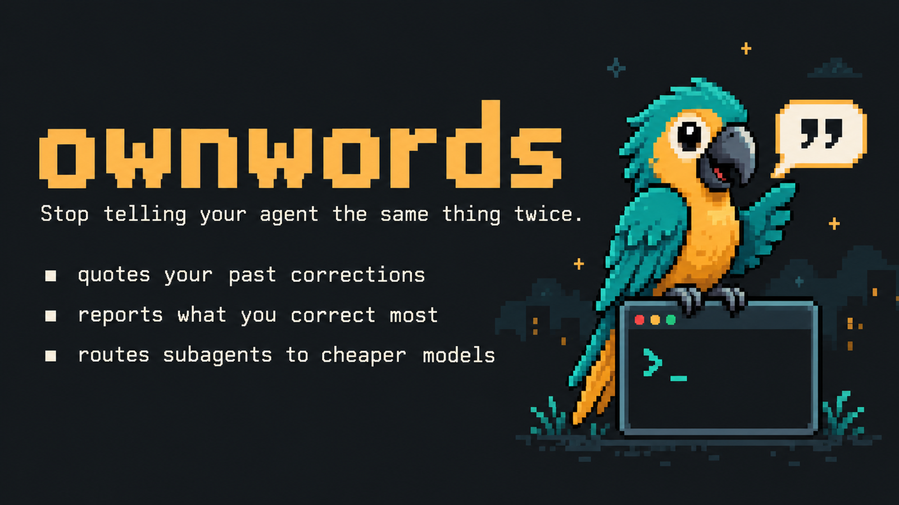
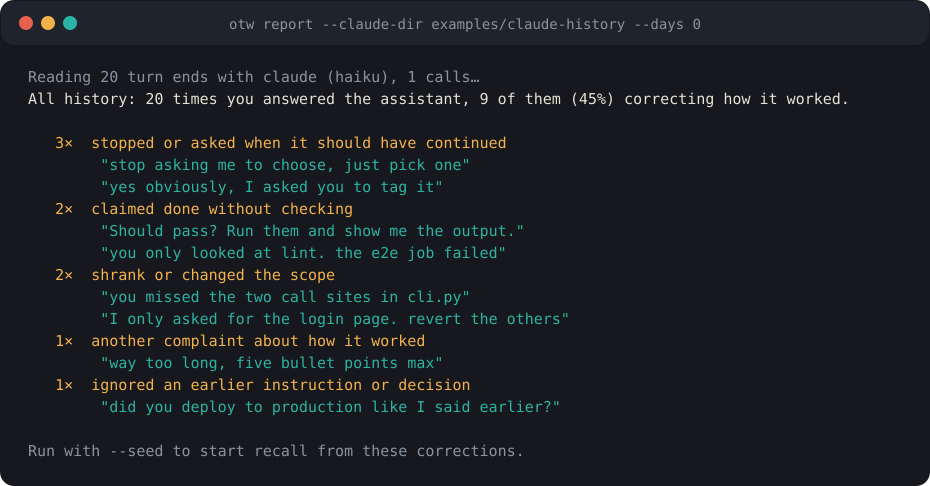
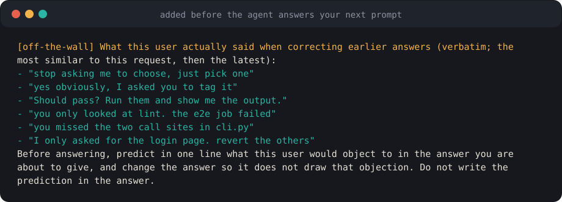
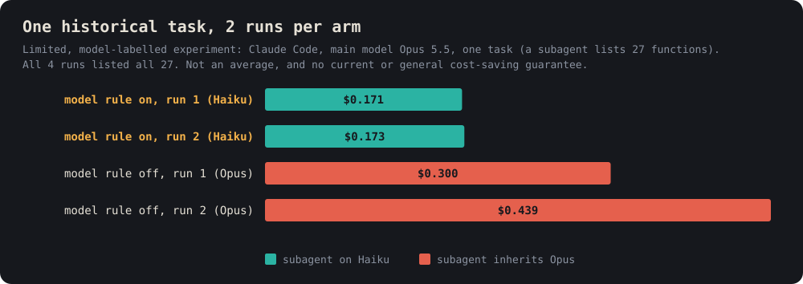
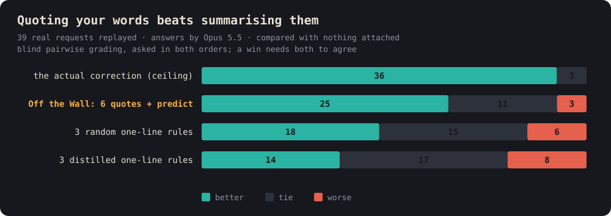

<p align="right">
  <a href="README.md">English</a> | <a href="README.ko.md">한국어</a> | <a href="README.ja.md">日本語</a> | <strong>中文</strong>
</p>

通俗说明(能做什么、不能做什么,末尾附测试细节):[中文](https://toranalytics.github.io/zh/otw-what-it-does/) · [English](https://toranalytics.github.io/en/otw-what-it-does/) · [한국어](https://toranalytics.github.io/otw-what-it-does/)。发布说明:[更新日志](CHANGELOG.md)。

<p align="center">
  
</p>

<h1 align="center">Off the Wall</h1>

<p align="center">
  <strong>让编程智能体重新想起你已经纠正过的事。</strong>
  <br/>
  <sub>适用于 <strong>Claude Code</strong> 和 <strong>Codex</strong> 的插件：把你在同一工作目录中以前的纠正原文放在下一次回答之前。</sub>
</p>

<p align="center">
  <a href="https://github.com/toranalytics/off-the-wall/actions/workflows/ci.yml"></a>
  <a href="https://github.com/toranalytics/off-the-wall/releases"></a>
  <a href="LICENSE"></a>
  
  
  
</p>

<p align="center">
  <a href="#quick-start">快速开始</a> ·
  <a href="#report">报告</a> ·
  <a href="#how">工作方式</a> ·
  <a href="#routing">模型选择</a> ·
  <a href="#evidence">依据</a> ·
  <a href="#privacy">隐私</a>
</p>

**在智能体回答之前，逐字引用你在同一工作目录中的纠正。提供一份在本地生成、由模型分类的报告，告诉你最常纠正什么。还提供子智能体的模型选择指引。**

“别问了，自己选一个做”“你真的跑过测试了吗？”这类纠正，通常到下一个会话就被忘了。Off the Wall 把这些消息保存在本地，并在
回答前，把同一工作目录中记录的最多 6 条纠正以你自己的原话交给智能体。它通过你已在使用的 `claude` 或 `codex` CLI 运行，
因此不需要单独的 API 密钥。这并不意味着没有任何内容离开你的机器，请见[隐私](#privacy)。

> 这是尚未成为正式版的 0.3.1 预发布版。目前测得的内容:在合成测试中,正确的过去纠正被引用时,智能体遵循模型原本无从得知的个人偏好的频率高得多(见 [Evidence](#evidence))。没有测量的内容:真实用户的长记录、其他模型、交互式使用。

> 早期版本说明：效果证据来自单个用户的文本回放实验，不保证普遍减少纠正、降低成本或改善任务完成。宿主或插件的自动通知可能被误判为用户回复。分享报告汇总前，请在本地核对原始消息。输入分类器仍可能把自动化文本误判为用户回复，也不是完美的人类输入检测器；报告中的次数是模型分类，可能有误。

---

## 为什么用 Off the Wall

| 问题 | 发生了什么 | Off the Wall |
| :-- | :-- | :-- |
| 重复的纠正 | 这个月第十次说“别问了，直接做” | 把你过去的话放在下一次回答之前 |
| 记不住的规则 | 把纠正总结成一行规则，效果很小 | 引用你自己的原话而不是总结。在一次小规模回放实验中，总结规则并不比随机规则好（[依据](#evidence)） |
| 所有子智能体都用大模型 | 连搜索、grep 也可能用最贵的模型 | 为每个子智能体选择模型的指引，以及退回缺少 `model` 参数调用的检查。不保证更便宜的路由或任何成本节省 |
| 又一个 API 密钥 | 记忆工具常常需要自己的 API 密钥 | 判定通过你已经在用的 `claude` 或 `codex` CLI 运行，因此不需要单独的密钥。摘录仍由你的提供商处理（[隐私](#privacy)） |

<a id="quick-start"></a>
## 快速开始

**1. 安装**

在 Claude Code 中输入：

```
/plugin install off-the-wall --marketplace toranalytics/off-the-wall
```

Codex：

```bash
codex plugin marketplace add toranalytics/off-the-wall
codex plugin add off-the-wall@off-the-wall
```

然后在 Codex 中打开一次 `/hooks` 并信任 Off the Wall 的钩子。在信任之前，Codex 不会运行插件钩子。

**2. 用示例历史试运行报告**（不需要你自己的记录）

```bash
git clone https://github.com/toranalytics/off-the-wall && cd off-the-wall
node bin/otw.mjs report --host claude --claude-dir examples/claude-history --days 0
```

**3. 用你自己的历史运行，并从中开始引用**

```bash
node bin/otw.mjs report --seed
```

不带 `--seed` 的 `report` 是用户明确要求的提供商处理，即使 `capture: false` 也可以运行。`--seed` 要求启用 capture，且直到分类结束，存储和配置均保持不变；授权撤销后，结果不会保存。

`--seed` 会重新读取你选择的历史，在宿主历史记录了工作目录时，附上来源信息（项目哈希和输入来源）再保存。
工作目录未知的回合不会被保存，只报告跳过的数量，也不会自动“安全晋升”。详见[范围与旧记录](#scope)。

需要 Node 18 或更高版本。目前在真实宿主上的确认有两项:一次 Codex 冒烟测试(codex-cli 0.162.1,0.2.0)和一次 Claude Code 无头模式运行(2.1.311,插件 0.2.1,保存与回溯),两者都已在 Evidence 中链接。Claude Code 的交互式使用以及当前 main 在真实宿主上的效果仍未验证。

<a id="report"></a>
如果没有反应：Codex 在你通过 `/hooks` 信任插件钩子之前不会运行它们，现在可用 `otw status` 查看钩子活动。

## 你最常纠正什么

<p align="center">
  
</p>

`report` 读取你机器上已有的 Claude Code 和 Codex 历史（`~/.claude/projects`、`~/.codex/sessions`），用一个小模型找出
你纠正智能体做事方式的回复。分类由模型完成，可能有误。上图是按当前 report 格式绘制的[示例历史](examples/claude-history)的存档分类。该历史是虚构的，
图并不是重新运行当前 CLI 或新调用模型的结果。它只展示 report 的样子，不说明
模型或用户会得到什么结果。选中的摘录会通过你自己的 `claude` 或 `codex` CLI 发送给模型。加上 `--seed` 会保存找到的
纠正，这样该项目从下一个提示开始就可以引用。

最后会打印一个链接，打开本仓库 [Discussions](https://github.com/toranalytics/off-the-wall/discussions/categories/show-and-tell)
中预填好的帖子，内容是你最常纠正的前三类及次数。只包含次数和类型名称，不包含任何被引用的原话。次数是模型分类，可能有误，请在本地核对原始消息，并在发布前自己审阅。不会自动发布。是否发布由你决定；
这是告诉我你的第一名是否和我一样的最快方式。

<a id="how"></a>
## 预先查看会回溯什么

`node bin/otw.mjs explain "<提示词>"`(其他工作目录加 `--cwd DIR`)会显示在回答该提示词之前,哪些已保存的纠正会被引用,并附上相似度分数和被排除的记录数。它是只读的,不调用模型,也不写任何文件。这是弄清为什么会出现意料之外的引用的最快办法。它在 main 上,尚未包含在 0.3.1 发布版中。

## 智能体看到什么

<p align="center">
  
</p>

| 时机 | Claude Code | Codex |
| :-- | :-- | :-- |
| 每个提示 | 引用最多 6 条过去的纠正（每条最多 200 字符）。只来自同一个规范化工作目录（项目键），且通过相关性门槛。不足 6 条或没有都很正常，不用其他项目的纠正或最新的来凑数 | 相同 |
| 每个提示 | 在独立进程中判定上一个回答和你的新消息，是纠正就连同项目哈希和输入来源一起保存 | 相同 |
| 回合结束 | 保留回答结尾供判定使用 | 相同 |
| 会话开始 | 添加路由规则 | 添加路由规则 |
| 子智能体启动 | 没有 `model` 的 `Agent` 调用每回合退回一次 | 没有 `model` 或 `reasoning_effort` 的 `spawn_agent` 调用每回合退回一次 |

没有任何步骤等待模型调用：判定在你的提示发出之后单独运行。

引用块中会明确写明：历史记录不是执行、发布、删除或披露的许可，当前请求和安全要求优先。

上图由 `scripts/make-assets.mjs` 对示例报告中的引用直接调用 `correctionBlock` 生成，只展示格式，并不是按相关性、
工作目录或相关性门槛实际选出的结果。

<a id="scope"></a>
### 范围与旧记录

- 引用需要工作目录和来源信息。没有 cwd 的提示，或没有项目键的记录，不会自动引用。
- 范围是规范化后的工作目录（以项目哈希保存）。子目录、移动后的目录和 git worktree 有意不会自动归并，
  各自是独立的项目。
- 新记录带有项目哈希和输入来源。没有项目或来源未知的旧记录仍保留在磁盘上，但不再被引用。不会删除或改写。
- `report --seed` 会重新读取你选择的历史，只追加项目和来源已知的记录，并报告因 cwd 未知而跳过的数量。
  不会再新存没有来源的记录，也不会自动“安全晋升”。
- 输入分类器会排除明确的元信息或非人类来源的文本以及已知的自动化封装，保留普通 Markdown 和较长的英文。
  它是过滤器，并不是完美的人类输入检测器。
- 相关性门槛（匹配守卫）判断保存的纠正与请求是否相似到值得引用。当前阈值是初始的工程设置，并不是
  经过校准的准确率，也不声称有某个精确率或召回率。
- 没有记忆管理界面。从 0.3.1 起，`otw forget --all --yes` 会删除所有已存的纠正、会话状态和日志，`otw forget --project --yes` 只删除当前工作目录的纠正；不带 `--yes` 时两者都只显示将被删除的内容。提供商那里的副本和你的 Claude Code/Codex 历史不受影响。在 0.3.1 之前，要清除本地记录，请自行删除 `~/.otw` 下的文件（[隐私](#privacy)）。
  `capture: false` 会停止保存新的提示和回答摘录（已保存的纠正不会被清除）。`status` 会显示带项目和来源标记的记录与被隔离记录的数量。

<a id="routing"></a>
## 子智能体模型选择指引

<p align="center">
  
</p>

主模型作为编排者，根据任务把什么留给子智能体来选择其模型。Off the Wall 只提供这个指引并检查是否缺少 `model` 参数，
不会强制模型，也不保证更便宜的路由或任何成本节省。图中只是一次历史测试，详见[依据](#evidence)。

| 等级 | 何时 | Claude Code | Codex |
| :-- | :-- | :-- | :-- |
| small | 检索或转换：查找、grep、列出、提取、格式转换 | `haiku` | 账号中的快速模型，`low` |
| mid | 有明确目标和标准：调查、评审、实现、测试 | `sonnet` | 主力模型，`medium` |
| large | 需要先判断问题是什么：根因、设计、迁移计划 | `opus` | 顶级模型，`high` |

几步就能完成的工作，由主模型自己做最便宜。Codex 的模型名因账号而异，所以 Off the Wall 读取 Codex 保存的列表
（`~/.codex/models_cache.json`），根据描述分成三个等级。

<a id="evidence"></a>
## 依据

**最新测量（2026-10-28）：模型无从得知的个人偏好。** Claude Code 2.1.311、haiku、无界面模式，由实验者以外的模型生成的合成库与任务，自动评分，计划在运行前固定。默认模型很少遵守这些偏好（提交格式、工具、语气、日期格式等）的 11 个任务，各运行 3 次。

| | 遵守偏好的次数 |
|---|---|
| 不召回 | 1/33 |
| Off the Wall 默认 | 9/33 |
| Off the Wall `recallWide`（0.3.0起默认） | 17/33 |

- 也用更大的模型(用 Claude Code 的 Sonnet 代替 haiku,相同的任务和库,66 次)跑过:不召回 2/33,当前默认 20/33;按任务看更好的 7 个、更差的 0 个(符号检验 p = 0.016)。合成习惯,每格 3 次。记录:[docs](docs/preference-experiment-2026-10-28.md)。
- 修复评分器缺陷后第三次重跑(实验5b,相同的库和任务,追加99次):不召回 2/33,原默认 14/33,`recallWide` 25/33。这只是方向一致的又一个样本;数字变高一部分来自修复,一部分来自每次运行的波动,所以不替换第一张表。记录:[docs](docs/preference-experiment-2026-10-28.md)。
- 在两个不同的库上都出现了同样的差距（16/33 对 8/33，17/33 对 9/33）。与不召回逐任务比较，`recallWide` 在 8 个任务上更好、没有更差的（p = 0.008）。
- 原因在于检索：正确的过往纠正出现在引用中时，模型遵守得多得多；找不到时没有变化。也并非总是有效：11 个任务中有 1 个（严格的“一句话”格式）即使展示了纠正也没有遵守。另一个同样是 0/3 的任务其实是事后发现的评分缺陷（会拒绝用代码块包起来的回答）；从记录重新阅读，看到纠正的 6 次中有 5 次遵守，没看到的 3 次为 0 次。该重新统计属于事后工作，上面的数字仍是原始值，因此低估了效果。
- 在默认模型本来就能避免的错误上没有发现收益（16 个任务中 14 个无需召回也通过）。
- 未验证：真实用户的长历史、haiku 和 Sonnet 以外的其他模型(例如 Opus、Codex 模型)、交互式使用、长期效果。这里的纠正是模型写的合成数据。详情见 [docs/](docs/)。


<p align="center">
  
</p>

所有测量数字都来自一个人的历史（9/20 的报告示例来自虚构会话），是探索性的初步结果，而不是普遍规律。
公开的这个虚构演示只能确认上下文按说明的方式构建，不说明任何模型或用户结果。

**这是一个人的文本回放实验，不是普遍发现。** 从一位用户的历史中挑选了 39 个请求，以文本形式重放。
它们实际上都紧接着出现过一条纠正，且该纠正仅凭文字即可判断。Opus 5.5 在每种条件下作答，
Sonnet（模型，不是人）在不知道来源的情况下两两比较，并交换顺序问两次，两种顺序都一致才算胜。Off the Wall 条件是 6 条引用
加上“预测反对意见”这一行，对比不附加任何内容为 25 胜 11 平 3 负，对比随机规则为 17 胜 14 平 8 负（只是 39 个样本上的倾向，
不是定论）。总结的一行规则没有胜过随机规则。这不是独立复现，也不说明在实际产品中有收益；由于引用和预测反对意见
这一行是一起测试的，也不能说明差异仅由引用造成。它不支持“引用优于总结”这样的一般性说法。
这次 39 个请求的实验没有使用当前的选择器或更新后的引用块措辞。

**模型选择。** 在另外留出的 30 次历史委派中，遵循三个等级规则的 Opus 选中人工标注模型 28 次，
从未选择更弱的模型。上面的成本图是一个范围有限、带模型标注的历史实验：一个任务、每组运行 2 次，使用当时的主模型和价格。
两组分别约便宜 43% 和 61%，但这只是参考，不是平均值，也不保证当前或普遍更便宜的子智能体或任何成本节省。
Codex 的模型对应是按同样等级类比得出的，没有测量。判定器的详细表格见 [English README](README.md#evidence)。

<a id="settings"></a>
## 设置

`~/.otw/config.json` 是可选的；文件不存在时使用正常默认值。有效的部分设置仍使用原有结构，显式值优先于自动检测。`recall`、`recallWide`、`capture` 和 `routing` 必须是真正的 JSON 布尔值，不能是字符串。支持文件开头的一个 UTF-8 BOM。已有文件若无法读取、JSON 格式错误、不是对象，或含错误类型、未知键、无效嵌套值，会安全关闭：四个标志全部变为 `false`，手动 `report` 也会在读取历史或调用提供商之前停止。`node bin/otw.mjs status` 仅显示经过安全处理的 `config-invalid`，不显示原始配置值或错误。

`recall` 控制引用，`capture` 控制新摘录的保存与纠正记录，`routing` 控制模型选择指引。所有键均可省略。配置示例见 [English README](README.md#settings)。

<a id="privacy"></a>
### 宽泛召回（自0.3.0起默认开启）

`recallWide` 自0.3.0起默认开启。去除首尾空白后达到20字符的提示会按相似度排序选取同项目最多6条合格引用，不受通常0.18下限限制，仍排除零重叠和重复记录。`"recallWide": false` 恢复原来的0.18下限；不足20字符的提示即使在宽泛模式下也保留此下限，`recall: false` 始终关闭召回。每个提示（包括无关提示）的成本是最多6条、每条最多200字符的引用，约300 token（仍受短提示保护和资格过滤限制）。在两个不同库上用Claude Code及haiku测试11项个人偏好任务、每项3次，两次合成实验的宽泛模式通过16/33和17/33，原默认模式为8/33和9/33。对14项无适用偏好的任务进行危害检查（每个条件42次），无召回40/42，宽泛召回41/42，没有任务在3次中损失2次或以上。平均输出token约增加9%（2,026对2,210），耗时16.5秒对17.8秒（不显著，仅供参考）。全部为单一小模型的无头合成测试，短提示保护本身未经测量，不能证明真实历史上的收益。 [Experiment](docs/preference-experiment-2026-10-28.md) · [exp4](docs/data/exp4) · [exp5](docs/data/exp5).

## 隐私

存储是本地的，但本地存储并不意味着没有任何内容离开你的机器。Off the Wall 在 `~/.otw` 中保存：
- `corrections.jsonl`（包括不再被引用的旧记录）
- 每个会话的状态
- `log.jsonl`
- report 和分享的次数（在你打开链接并自行发布之前，只保存在你的机器上）

会发送出去的内容如下，始终通过你自己的 `claude` 或 `codex` CLI，因此到达你自己的模型提供商：
- 判定会发送助手回答和你的回复的摘录；
- `report` 会发送所选历史的摘录；
- 引用会把被引用的纠正放入宿主模型的上下文。

没有发布者侧的遥测，也不需要单独的 API 密钥。但这不等于提供商不处理数据：提供商仍会看到这些摘录，
你的套餐用量或费用可能仍会适用。默认的事件日志和错误日志不包含原始摘录。设置 `OTW_DEBUG` 后，原始摘录可能被写入 `~/.otw/log.jsonl`。未知或过大的历史帧会安全地失败（拒绝处理），不会据此猜测项目或待处理状态。删除 `~/.otw` 会忘记 Off the Wall
保存的内容，但不会清除你的 Claude Code 或 Codex 历史，也不会清除提供商保留的副本。`otw forget` 自 0.3.1 起提供；0.3.0 及更早版本没有删除命令。分享需要手动操作：
Discussions 链接只预填次数和类型名称，发布前由你自己审阅。

### Capture 控制与删除

- 符合条件的前台 capture 或显式的 `report --seed` 会在需要时创建 `.capture-generation` 和空的目标文件。任务绑定该代标记、存储根目录及纠正文件的身份、配置的文件系统修订信息，并在调用提供商前和追加保存前重新检查。缺少该存储授权的旧队列任务会被丢弃；已有纠正原样保留，不静默迁移。 配置文件不存在时还会检查根目录的修订信息，因此无关条目的创建或删除也可能保守地使旧任务失效。

- 关闭 capture、配置修订变化、删除 `corrections.jsonl`，或删除/替换整个存储后，旧结果不会保存，也不会写入调试摘录。工作进程不会重建目录。新的前台人工提示/会话可以初始化新存储，但旧结果不能进入其中。删除整个存储也会删除配置，因此下次符合条件的提示/会话可能按默认值重新启用 capture。

- 这撤销的是结果存储授权，不是终止进程或收回已发送的文本。已发出的提供商调用仍可能完成并消耗用量。手动编辑或截断文件不是删除/撤销命令：请删除纠正文件或存储文件夹。元数据和时间戳的敏感性取决于文件系统，不能保证对所有外部写入都能原子、即时取消。

- 在 POSIX 上，新目录/文件请求 `0700`/`0600` 权限，不会统一修改已有权限。会话写入使用临时文件加 rename 原子替换，但不保证所有并发钩子的顺序，也不保证损坏状态的恢复。没有逐条记忆管理界面或新的 clear/pause 命令。

## 限制

- 原生判定器的工具/上下文隔离仍未修复；真实宿主的重新加载及效果仍未经验证。
- Windows：CI 覆盖 Windows、Linux、macOS 的 Node 18/20/22，当前结果请查看 PR 检查。尚未验证 Windows 上真实的 Claude Code/Codex 会话；两个 POSIX 模拟提供商集成测试在 Windows 上跳过。
- 判定有时会漏掉（Claude Haiku：精确率 0.82，召回率 0.72，基于一位用户的标注）。
- 输入分类器和相关性门槛都是过滤器。自动化文本仍可能被当作回复，相关的纠正也可能被漏掉。
- 范围精确到同一工作目录。相关文件夹、移动后的项目和 worktree 之间不共享引用。
- 引用只对模型可见，会话中不会显示给你。
- 暂时没有记忆管理界面。已保存的记录可用 `otw forget`（自 0.3.1 起）删除。

## 收录于

- [awesome-codex-plugins](https://github.com/hashgraph-online/awesome-codex-plugins)
- [awesome-ai-plugins](https://github.com/hashgraph-online/awesome-ai-plugins)
- [awesome-ai-agent-tools](https://github.com/michielhdoteth/awesome-ai-agent-tools)
- [Awesome-Vibe-Coding](https://github.com/0xWelt/Awesome-Vibe-Coding)
- [awesome-vibe-coding-resources](https://github.com/acvnace/awesome-vibe-coding-resources)
- [awesome-coding-agents](https://github.com/kailiu42/awesome-coding-agents)
- [awesome-agent-memory](https://github.com/mnemoverse/awesome-agent-memory)
- [awesome-context-engineering](https://github.com/yzfly/awesome-context-engineering)
- [awesome-agent-memory](https://github.com/mnemoverse/awesome-agent-memory)

社区插件目录: [Claude & Codex Plugins](https://claudecodexplugins.com/plugins/toranalytics/off-the-wall/off-the-wall).

## 许可证

MIT © [Junebeom Seo](https://github.com/toranalytics)

[Privacy](https://github.com/toranalytics/off-the-wall#privacy)
